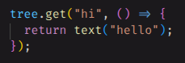
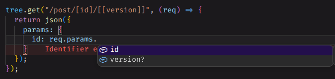
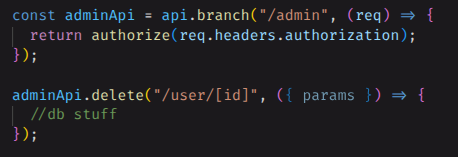

a small, typed routing package built around node's built-in `http` server.

```ts
import { root, json } from "@tally.paws/httptree";

const tree = root();

tree.get("/users/[id]", (req) => json({ id: req.params.id }));

await tree.listen(3000);
```

## Features

- **return responses**: handlers return a string, number, object, stream or a helper like `json()` and httptree turns it into the response
  <!--  -->

- **typed params**: `"/users/[id]"` makes `req.params.id` a `string`, `[[page]]` is optional and `[...rest]` is a `string[]`
  <!--  -->

- **branches with guards**: a branch is a subrouter that inherits its path and params, give it a guard function and one line protects the whole subtree
  <!--  -->

- **built in body parsing**: json (with `validate`), forms and file uploads, with size limits set once for the whole tree, no body-parser or multer
- **first class websocket support**: same path syntax, same branches and guards as http routes
- **errors you control**: automatic `404` and `405` errors, and error handlers are configurable per type and per branch
- **extensions**: `root().extend(cookies).extend(cors())` adds typed members and middleware to a tree, official ones for cookies, cors, compression, static files, ip and validate, see [the extensions guide](./extensions.md)
- **no required runtime dependencies**: just node's `http`, with `ws` and `busboy` optional for websockets and forms

see [the quickstart guide](./quickstart.md)


say hi to yi xi
